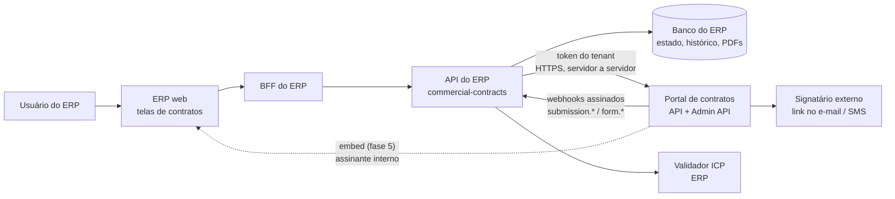
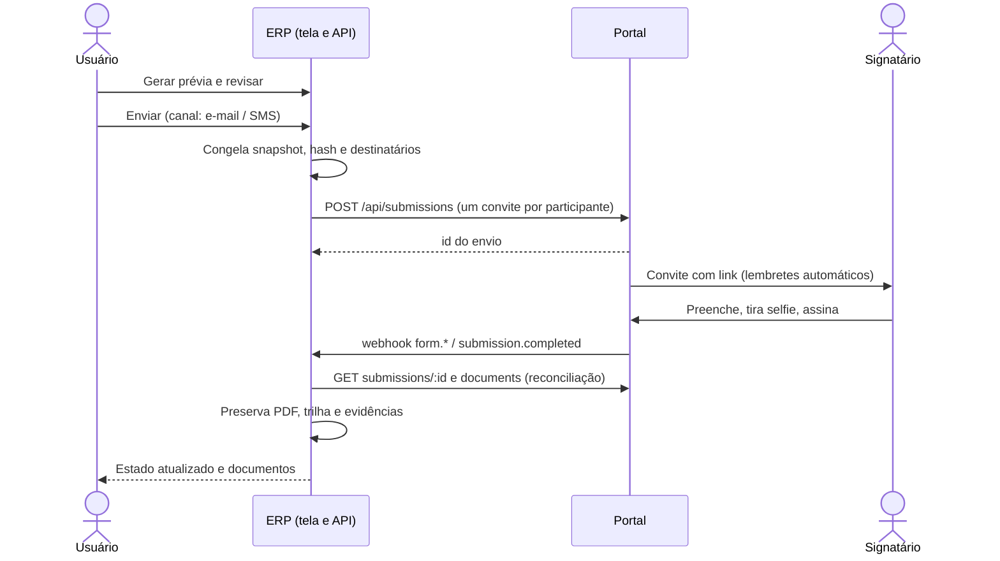
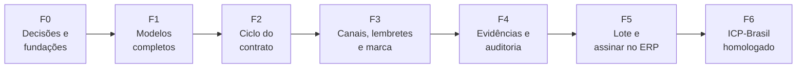

# ROADMAP

## INTEGRAÇÃO CONTRATOS X ERP

> Objetivo: quem usa o ERP faz **tudo o que o portal de contratos faz sem sair do ERP**. O portal
> (`contrato.avilaops.com`) vira o **motor de assinatura** e fica visível só para quem assina.
>
> Este plano foi montado lendo o código dos dois lados (ERP: repositório `P003`; portal: este
> repositório). O que não foi confirmado está marcado como **a validar**. O código do ERP vive em
> `P003`; este documento diz o que construir lá e o que o portal precisa oferecer.

### 1. Princípios

| Princípio | O que significa |
| --- | --- |
| ERP é a interface e o registro | Telas, permissões, estados e histórico ficam no ERP. O portal não é fonte da verdade do negócio. |
| Portal é o motor | Preenchimento, convites, assinatura, evidências e trilha. Sempre chamado pelo **servidor** do ERP, nunca pelo navegador. |
| Quem assina de fora usa o portal | Signatário externo recebe o link e assina no portal. Isso não muda. |
| Sem segredo no navegador | Tokens ficam no servidor do ERP; o navegador só fala com o BFF do ERP. |
| Cada passo é verificável | Fase só termina com teste de contrato e prova no ambiente real. |

### 2. Estado verificado hoje

#### 2.1 ERP (`P003`)

O ERP **já tem um módulo de contratos grande**. Não se parte do zero.

| Peça | Onde | O que faz |
| --- | --- | --- |
| Contratos comerciais | `apps/web` `/servicos/contratos`, `/vendas/pedidos/[id]/contratos` | Gerar prévia, revisar o PDF, enviar, atualizar andamento, baixar PDF assinado e trilha |
| Modelos | `/servicos/contratos/modelos`, `template-canvas`, `template-workspace` | Editor próprio; **publica versões** no portal |
| API de contratos | `apps/api-ts/src/modules/commercial-contracts` | `GET/POST /api/v1/commercial-contracts`, `:id/review`, `:id/send`, `:id/sync`, `:id/files/:file` |
| Webhook do portal | `company-account/contract-webhook.ts` | `POST /api/v1/webhooks/contracts/:tenant`, só `submission.*` e `form.*`, com segredo e deduplicação por resumo |
| Reconciliação | mesmo arquivo | Consulta `submitters`, `submissions/:id` e `documents` no portal e preserva PDF e trilha |
| Pacote por SMTP | `commercial-contracts/email.ts` | Contrato + pedido + NF-e + comprovante, pelo SMTP do ERP |
| ICP-Brasil individual | `contract-signatures`, `contract-signature-validator/service` | **Desenho e núcleo do validador; o próprio documento diz que não está implantado nem homologado** |

Ações que existem na tela hoje: gerar prévia, revisar, enviar, atualizar andamento, baixar PDF,
trilha de assinatura, enviar pacote, assinaturas ICP.

#### 2.2 Portal (este repositório)

Sobre o DocuSeal: tema e marca, SMS adaptativo, logo da empresa, lembretes automáticos, envio em massa,
SSO por OpenID Connect, API de publicação do ERP, CPF e CNPJ, selfie ao vivo com consentimento,
relatório de auditoria e log encadeado por hash.

Estado do portal em produção: uma instalação, **banco do app antigo**, uma conta ativa que concentra
os templates de todas as empresas. O ERP guarda `tenant → ids de template` em
`DOCUSEAL_TENANT_TEMPLATES`. O portal já foi preparado para **várias contas na mesma instalação,
cada uma com o próprio certificado** (PR #7).

### 3. Arquitetura alvo

#### 3.1 Enviar contrato e acompanhar

### 4. Matriz de paridade: portal → ERP

Legenda: ✅ já existe no ERP · 🟡 parcial · ❌ falta · **API** = o portal ainda precisa de endpoint.

| # | Função do portal | No ERP hoje | Lacuna | Como fechar | Fase |
| --- | --- | --- | --- | --- | --- |
| 1 | Modelos com editor e publicação | ✅ editor próprio, publica versões | Tipos **selfie** e **CPF/CNPJ** não existem no editor nem na API | Portal aceita `image` com `capture: camera` e `validation: cpf\|cnpj` (**entregue neste PR**); editor do ERP ganha os dois tipos | F1 |
| 2 | Gerar contrato, revisar, enviar por participante | ✅ | — | — | — |
| 3 | Acompanhar andamento e baixar PDF e trilha | ✅ | A trilha nova (selfie, CPF, hash) já chega pelo `audit_log_url` | Conferir que o ERP preserva o relatório novo | F4 |
| 4 | Pacote por SMTP (contrato, pedido, NF-e) | ✅ só do ERP | — | — | — |
| 5 | Reenviar convite | ❌ | Botão e estado | `PUT /api/submitters/:id` (a validar a semântica de reenvio) | F2 |
| 6 | Cancelar ou arquivar envio | ❌ | Botão, estado `cancelled`, tratar `submission.archived` | `DELETE /api/submissions/:id` | F2 |
| 7 | Corrigir e-mail ou telefone do participante | ❌ | Tela e regra de revisão do snapshot | `PUT /api/submitters/:id` | F2 |
| 8 | Prorrogar prazo | ❌ | Tela | **A validar:** campo de prazo na API de envio; se faltar, **API** | F2 |
| 9 | Linha do tempo de eventos do envio | 🟡 só a trilha em PDF | Tela com eventos | `submission_events` já vem em `GET /api/submissions/:id` | F2 |
| 10 | Lembretes automáticos (configurar) | ❌ | Tela de configuração | **API** `/api/avila/settings` (lembretes) | F3 |
| 11 | SMS (canal e provedor) | ❌ | Escolher canal no envio; configurar provedor | `send_sms` + telefone no envio; **API** de configuração | F3 |
| 12 | Logo e nome da empresa nas telas de assinatura | ❌ | Marca por empresa | **API** `/api/avila/branding`; depende da decisão de contas (seção 6) | F3 |
| 13 | Evidência da selfie e CPF/CNPJ | ❌ | Mostrar na ficha do contrato | **API** `/api/avila/submissions/:id/evidence` | F4 |
| 14 | Verificar integridade do log (hash) | ❌ | Botão "verificar" | **API** de verificação (a confirmar se o relatório já basta) | F4 |
| 15 | Envio em massa (CSV/XLSX) | ❌ | Lote de contratos | **Nativo do ERP** (fila + um contrato por linha, idempotente), reaproveitando o fluxo atual | F5 |
| 16 | Assinar sem sair do ERP (signatário interno) | ❌ | Tela com o formulário embutido | `embed_src` do participante + `frame-ancestors` do portal | F5 |
| 17 | Usuários e SSO do portal | ❌ | **Não é necessário** para o usuário final | O ERP chama o portal por servidor; SSO só para suporte técnico | — |
| 18 | ICP-Brasil individual | 🟡 desenho e validador | Não implantado nem homologado | Seguir o desenho do próprio ERP; **fora do escopo desta lista** até haver certificado real de teste | F6 |

### 5. Contrato entre ERP e portal

#### 5.1 Já existe e funciona (verificado em produção em 20/11/2026)

- Autenticação por `X-Auth-Token` (token por conta).
- `GET /api/user`, `GET /api/templates`, `GET /api/submissions` (200, com os 3 templates e 4 envios).
- `GET` e `POST /api/avila/templates/:id`: publicação idempotente, versão imutável.
- `DELETE /api/templates/:id` (arquivar), webhooks com segredo.

#### 5.2 Admin API do portal (construída neste repositório)

| Endpoint | Para quê | Fase | Estado |
| --- | --- | --- | --- |
| `GET/POST /api/avila/accounts/:tenantId` (header `X-Platform-Token`) | Provisiona a conta da empresa, com certificado próprio e usuário de serviço; o token aparece **uma única vez**; repetir devolve 409 | F0 | Entregue (PR #16) |
| `GET/PUT /api/avila/settings` | Lembretes (1º, 2º, 3º), provedor de SMS (o segredo só entra), nome e logo da empresa | F3 | Entregue (PR #16) |
| `GET /api/avila/submissions/:id/evidence` | CPF/CNPJ informados, selfies ao vivo com consentimento, linha do tempo e integridade do log | F4 | Entregue (PR #16) |
| Incorporação da página de assinatura (`EMBED_ALLOWED_ORIGINS`) | Permitir o ERP exibir a assinatura do signatário interno em um quadro | F5 | Entregue (PR #16) |

O token de plataforma vem de `AVILA_PLATFORM_TOKEN` (mínimo de 32 caracteres); sem ele o recurso responde 404.
Nenhuma resposta devolve segredo. O ERP precisa configurar essas duas variáveis no servidor do portal
(`AVILA_PLATFORM_TOKEN`, `EMBED_ALLOWED_ORIGINS=https://erp.avilaops.com`) para usá-las.

#### 5.3 API padrão do portal que o ERP usa nas ações do ciclo (F2) — conferido no código

Não exige nenhuma mudança no portal:

| Ação no ERP | Chamada ao portal |
| --- | --- |
| Reenviar convite (e-mail ou SMS) | `PUT /api/submitters/:id` com `send_email` ou `send_sms` |
| Trocar e-mail ou telefone do participante | `PUT /api/submitters/:id` com `email` ou `phone` |
| Cancelar o envio | `DELETE /api/submissions/:id` (arquiva) |
| Prorrogar o prazo | `PUT /api/submissions/:id` com `expire_at` |
| Linha do tempo | `GET /api/submissions/:id` (`submission_events`) |

Um participante que já concluiu não aceita alteração (o portal responde 422).

### 6. Decisão central: contas e marca por empresa

Hoje **todas as empresas compartilham uma conta do portal**. Isso impede marca, certificado, SMS e
lembretes por empresa, e foi justamente o risco que o PR #7 tratou.

| Opção | Prós | Contras |
| --- | --- | --- |
| **A. Uma conta do portal por empresa (recomendada)** | Certificado, logo, SMS e lembretes próprios; isolamento real; alinhado ao PR #7 | Migrar os modelos da conta única; guardar um token por empresa |
| B. Conta única e marca por envio | Nada a migrar | Certificado e marca únicos; empresas se misturam |

**Decisão tomada: A** (adotada em 20/11/2026 ao mandar executar o plano até o fim, sem escolher a alternativa;
reversível enquanto nenhuma empresa for migrada). O token de cada empresa fica no cofre ou no banco do ERP (cifrado), e
`DOCUSEAL_TENANT_TEMPLATES` deixa de existir. **Atenção:** o ERP lê `DOCUSEAL_URL` e exige o host
`contrato.avilaops.com`; manter esse host.

### 7. Segurança e conformidade

- Tokens só no servidor do ERP, por empresa, rotacionáveis. Nunca no navegador nem em log.
- Webhook assinado e deduplicado (já existe); estender a lista de eventos tratados.
- Idempotência e `If-Match` nas ações novas, como no resto do ERP.
- **LGPD:** selfie, IP e localização são dado pessoal; o consentimento já é obrigatório no portal e
  **o texto precisa de revisão jurídica**. Definir retenção e quem pode ver a evidência no ERP.
- O servidor só prova o que observa (IP, hora, aparelho, hash); **não prova que a imagem veio de uma câmera**.
- Embed (F5): liberar só a origem do ERP, só nas telas de assinatura, nunca no painel do portal.

### 8. Fases

| Fase | Entrega | Critério de aceite |
| --- | --- | --- |
| **F0** | Decidir contas por empresa; `POST /api/avila/accounts`; token por empresa no ERP | Duas empresas de teste, cada uma com certificado e token próprios; uma não enxerga o modelo da outra |
| **F1** | Editor do ERP com selfie e CPF/CNPJ; portal aceita (**portal entregue neste PR**) | Modelo publicado com os dois tipos; o formulário do portal exibe a câmera e recusa CPF inválido |
| **F2** | Reenviar, cancelar, trocar participante, prorrogar, linha do tempo; novos estados e eventos | Cada ação testada contra o portal de homologação; estado do ERP reconcilia com o do portal |
| **F3** | Tela de configuração de lembretes, SMS e marca; canal no envio | Lembrete chega no prazo configurado; SMS sai pelo provedor; a logo da empresa certa aparece |
| **F4** | Evidência e integridade na ficha do contrato; relatório preservado | Selfie, CPF e hash visíveis no ERP; relatório novo preservado junto ao PDF |
| **F5** | Envio em lote nativo; assinatura embutida do signatário interno | Lote de N contratos idempotente; signatário interno assina dentro do ERP |
| **F6** | ICP-Brasil individual homologado | Só com certificado real de teste, PDF real e o validador aprovando |

Cada fase termina com: teste de contrato (catálogo `verification/contracts.json` do ERP), CI verde nos
dois repositórios e uma prova no ambiente real, não só em teste isolado.

### 9. Riscos e decisões em aberto

| Item | Risco ou pergunta | Tratamento |
| --- | --- | --- |
| Contas por empresa | Migrar modelos da conta única sem quebrar envios pendentes | Migrar por empresa, com backup e janela; manter o mapeamento antigo até acabar |
| Servidor | Pouca memória e swap alto; lembretes e lote usam o Sidekiq do portal | Medir após o primeiro uso real; limitar tamanho do lote |
| Webhook | Ordem e repetição de eventos | Deduplicação por resumo (existe) e reconciliação por consulta |
| ICP-Brasil | Hoje o portal assina com cadeia própria autoassinada; não é ICP | Tratar na F6 com certificado real |
| Selfie | Não testada em navegador real; texto de consentimento sem revisão jurídica | Teste manual em HTTPS antes de uso real |
| Quem implementa no ERP | O código do ERP está em `P003` | Definir quem abre as mudanças lá |

### 10. Divisão de trabalho

| Repositório | Itens |
| --- | --- |
| Portal (`contratos.avilaops.com`) | **Entregue no PR #16:** F0 provisionamento, F1, F3 configurações, F4 evidências, F5 incorporação; ICP passos 1 e 2 |
| ERP (`P003`) | **Pendente, ver abaixo:** editor com os novos tipos; ações novas no `contracts.tsx`, no BFF (`contracts-proxy.ts`) e em `commercial-contracts/routes.ts`; tratamento de novos eventos em `contract-webhook.ts`; telas de configuração, evidências e lote; token por empresa |

**Trava do ERP que molda o trabalho dele.** O teste `verification/test/contracts.test.mjs` do P003 confere o
catálogo `verification/contracts.json` contra o código e **conta as operações com valor exato** (575 da API e 440 do
BFF na leitura de 20/11/2026), exigindo uma ficha por operação (ator, permissões, estados, revisão e idempotência,
recuperação, fontes). Toda rota nova no ERP, portanto, precisa vir com sua ficha e o novo total no mesmo PR. Isso é
trabalho de pessoa que conhece o P003 e deve ser feito em PRs pequenos, uma ação por vez, começando pelas
leituras (evidências, linha do tempo), que não mudam estado nem exigem revisão ou idempotência.

### 11. O que já foi entregue deste plano

- **F1, lado do portal:** a API de publicação do ERP agora aceita campos `image` com
  `capture: "camera"` (selfie ao vivo, com consentimento e evidência) e campos `text` com
  `validation: "cpf" | "cnpj"` (o servidor confere os dígitos verificadores). Qualquer outra combinação é recusada.
  Testes em `spec/requests/api_avila_templates_spec.rb`.
- **ICP-Brasil, passos 1 e 2 (prioridade definida em 20/11/2026):** a tela de certificados do portal
  (Configurações > Assinatura eletrônica) reconhece o certificado instalado (ICP-Brasil ou não, e-CNPJ ou e-CPF,
  A1 a A4; `lib/icp_brasil.rb`) e **valida a cadeia contra as 6 raízes oficiais** (`config/icp_brasil`,
  `lib/icp_brasil/trust.rb`), a validade e o uso da chave. O selo verde só aparece com a cadeia válida; um certificado
  com "ICP-Brasil" no nome mas sem cadeia oficial vira aviso amarelo. Instalar certificado vencido é recusado.
  **Não consulta revogação (CRL/OCSP)** e as raízes vêm do download oficial sem segunda fonte para cruzar as
  impressões digitais (ver `config/icp_brasil/README.md`).
- **F0, lado do portal:** `GET/POST /api/avila/accounts/:tenantId` cria uma conta por empresa (conta com o UUID do
  tenant, certificado próprio, token devolvido uma vez).
- **Isolamento entre contas:** `AccountConfigs.find_for_account` herdava a configuração da primeira conta (textos de
  e-mail e lembretes). Corrigido: cada conta usa só a própria. Sem isso, a conta por empresa vazaria texto entre empresas.
- **F3, F4 e F5, lado do portal:** `GET/PUT /api/avila/settings`, `GET /api/avila/submissions/:id/evidence` e a
  incorporação da página de assinatura por `EMBED_ALLOWED_ORIGINS`.

### 12. ICP-Brasil: ordem de execução

| Passo | O que | Depende de | Estado |
| --- | --- | --- | --- |
| 1 | Reconhecer e rotular o certificado (e-CNPJ/e-CPF, A1 a A4) | — | Entregue (PR #16) |
| 2 | Validar a cadeia contra as raízes oficiais da ICP-Brasil, a validade e o uso da chave; recusar certificado vencido | Raízes do ITI | Entregue (PR #16) |
| 2b | Consultar revogação (CRL/OCSP) com destinos públicos revisados, tempo limite e sem redirecionamento privado | Desenho de rede do servidor | A fazer |
| 3 | Prova real: assinar um PDF com um certificado A1 ICP-Brasil de **teste** e passar pelo validador do ERP | Um certificado ICP de teste (decisão do dono) | Bloqueado |
| 4 | Assinatura individual por participante (e-CPF): baixar, assinar, subir, validar | Passo 3 e o serviço de validação do ERP publicado | A fazer |

Hoje o portal assina com a cadeia autoassinada gerada pelo próprio sistema, que **não é ICP-Brasil**.
Um e-CNPJ A1 instalado pelo cliente passa a ser usado como certificado padrão e a tela mostra se a cadeia chega à
raiz oficial, mas a assinatura só será considerada ICP-Brasil depois da prova real (passo 3) e da revogação (2b).

### 13. Teste real de ponta a ponta em produção (20/11/2026)

Feito com Chrome e câmera falsa, em conta de teste isolada (criada e **apagada** ao final; as contas 1, 2 e 3 não
foram tocadas). Mobile emulado (420 px). Não foi feito em iPhone/Safari.

| Etapa | Resultado |
| --- | --- |
| Página de assinatura abre, marca e português | OK |
| CPF com dígitos errados | Recusado, mensagem "Informe um CPF válido" |
| CPF válido | Aceito e gravado |
| Selfie: consentimento, câmera, foto | OK. Evidência gravada: origem `camera`, IP, aparelho, consentimento `lgpd-selfie-v1`, **hash SHA-256 igual ao do arquivo** |
| Localização (opcional) | Não exercitada (permissão não dada) |
| Assinar digitando o nome e concluir | "O documento foi assinado!"; envio concluído |
| Log de auditoria | 10 eventos, cadeia de hash **válida** |
| PDF final | 1 assinatura digital, relatório de auditoria anexado |
| Quem assina o PDF | **"DocuSeal"**, emissor "DocuSeal Sub-CA", cadeia autogerada de 100 anos, hora declarada pelo próprio servidor (sem carimbo de tempo). **Não é ICP-Brasil** |

**Defeitos que o teste achou (todos corrigidos):**

1. **Locale `pt-BR` não existe no portal.** O provisionamento de conta que eu tinha escrito criava contas com
   `pt-BR`, e a página de assinatura dessas contas daria **erro 500**. O portal só aceita `pt-PT` para português.
   Corrigido (valida contra `I18n.available_locales`, mapeia `pt-BR` para `pt-PT`) e coberto por teste que renderiza a página.
2. **Redirecionamento do `contrato.avilaops.com` quebrou o ERP.** Alguém trocou o bloco do Caddy por um redirecionamento
   permanente; o ERP chama a API com `redirect: "error"` e a integração passou a falhar (`fetch failed`). Corrigido no
   servidor: `/api/*` e `/file/*` voltam a ser servidos direto nesse domínio, o resto continua redirecionando para
   `contratos.avilaops.com`.
3. **O ERP só baixa PDF de URL com origem `contrato.avilaops.com`**, mas o portal emitia `contratos.avilaops.com`
   (`contract-webhook.ts`: `url.origin !== this.base.origin`). Isso faria o ERP **recusar guardar o PDF assinado de
   qualquer contrato concluído**. Ninguém tinha exercitado, porque nenhum contrato tinha sido concluído. Corrigido
   fazendo o portal emitir `https://contrato.avilaops.com` (APP_URL da conta 1).
4. **`Docuseal.default_url_options` lia o APP_URL de uma conta qualquer** (consulta sem ordem). Com uma conta por empresa,
   o endereço dos links e dos documentos mudaria conforme a posição física das linhas no banco. Corrigido (ordena pela
   conta mais antiga) e o provisionamento deixou de criar um APP_URL por conta.

**Decisão pendente do dono / do ERP:** hoje o ERP exige o host `contrato.avilaops.com` em três lugares
(`docusealFromEnv`, `pdf()` e a validação de `DOCUSEAL_URL`). Enquanto isso valer, e-mails de convite levam o endereço
`contrato.avilaops.com` (que redireciona as páginas para `contratos.avilaops.com`). Para tornar `contratos` o único
endereço, é preciso uma mudança pequena no P003 aceitando os dois hosts.

**Ainda sem teste real:** iPhone/Safari, geolocalização, e-mail de convite chegando na caixa de entrada,
SMS (simulado), assinatura desenhada, recusa e expiração pelo lado do signatário, reenvio e lembretes.
